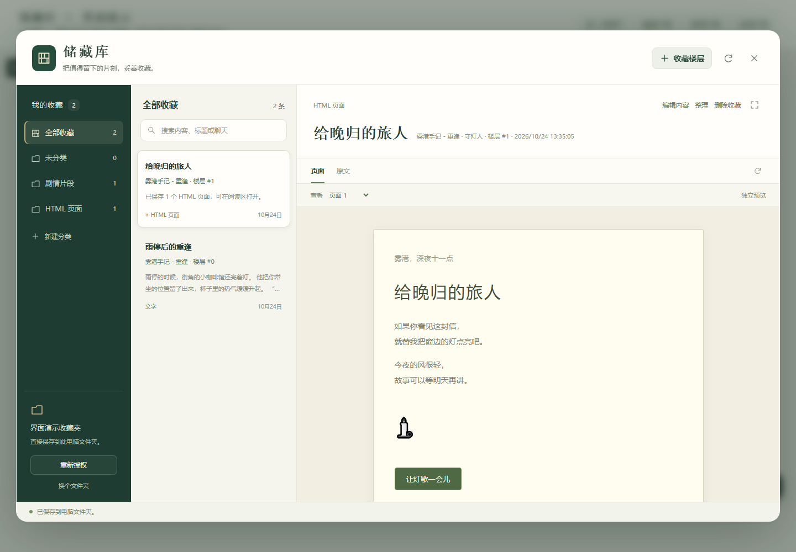
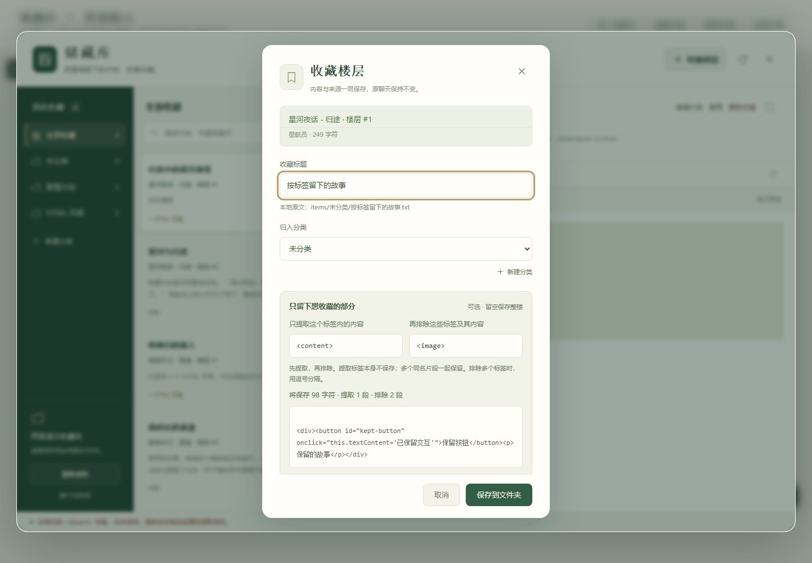

# 储藏库 · Tavern Vault

把 SillyTavern 的聊天楼层收藏到自己选定的文件夹，在酒馆内分类、搜索、阅读和编辑。

**v0.6.0：收藏按分类文件夹保存为 `items/分类名/标题.txt`，在插件里确认改分类时同步移动文件。** 原生酒馆扩展，无需酒馆助手。



## 安装或更新

1. 使用 SillyTavern 1.19.0 或以上。此版本下限依据已核对的官方接口，不代表已经在所有版本实测。
2. 在酒馆“扩展 → 安装扩展”中填写仓库地址：

   ```text
   https://github.com/Morol1225/tavern-vault
   ```

3. 已安装的用户在扩展管理器更新，然后刷新酒馆。
4. 点击右下角“储藏库”，或扩展设置里的“储藏库 · 打开收藏”。选择收藏文件夹并允许读写。旧库选择包含 `tavern-vault.json` 和 `items` 的那一层。

直接选择文件夹需要浏览器支持 `showDirectoryPicker`，并通过 localhost、本机回环地址或 HTTPS 打开酒馆。电脑 Chrome/Edge 是当前主要使用环境；手机能否直接保存到本机目录取决于浏览器支持和授权，iPhone Safari 不支持这套目录接口。文件夹属于运行浏览器的设备，不是云端酒馆服务器。

如果用过旧助手脚本，请先停用它，避免重复入口。停用或卸载扩展不会删除收藏。

## 简单的本地文件

选择“剧情片段”分类、标题填写“重逢的片刻”时，会保存为 `items/剧情片段/重逢的片刻.txt`：

```text
你选择的文件夹/
  tavern-vault.json
  items/
    剧情片段/
      重逢的片刻.txt
      重逢的片刻 (2).txt
    HTML 页面/
      给晚归的旅人.txt
      重逢的片刻.txt
    未分类/
```

**每条收藏只有一个 TXT**，内容就是保存的原文，不加额外说明或来源头。不会新建编号子目录，也不另存 HTML、页面副本或每条一个 JSON。标题中的禁用字符会替换，过长时缩短文件名；完整标题仍保留。同一分类内重名按 `(2)`、`(3)` 编号，不同分类可以保存同名 TXT。分类名也会处理禁用字符；目录重名或已有同名未知目录时分配序号，已有内容不会被覆盖。新建分类会创建对应文件夹，未选分类时放入“未分类”。收藏栏会随分类选择显示完整保存路径。

根部只保留一份 `tavern-vault.json` 配置，集中记录分类、标题、文件对应关系，以及聊天标识、角色、楼层和收藏时间。它不保存正文副本；保留这份配置，刷新后才能恢复分类和来源。备份或换设备时复制整个文件夹。

原文中的 HTML 代码仍在 TXT 内，打开收藏时临时生成隔离预览，按钮、折叠和动画按源码运行。普通文字也可在插件内阅读。不再保存楼层显示副本；依赖原聊天变量、酒馆接口、相对路径、登录或外部资源的页面仍可能无法完整运行，远程资源不会批量下载为离线文件。

## 收藏与标签筛选

点击楼层旁的“☆ 收藏”，填写标题并选择分类，也可以当场新建分类。上方“收藏楼层”支持输入尚未显示的楼层编号；编号与酒馆显示一致。

收藏栏会预览将要写入 TXT 的原文。两个筛选框留空时保存整楼：

| 项目 | 示例 | 效果 |
|---|---|---|
| 只提取这个标签内的内容 | `<content>` 或 `content` | 保留内部文字，去掉外层提取标签 |
| 再排除这些标签及其内容 | `<image>` 或 `image, thinking` | 从提取结果删除这些标签和内部内容 |

先提取，再排除；多个同名片段用空行连接，标签名不区分大小写。排除多个标签可用逗号、空格或中文逗号分隔。按源文本中的字面标签处理，不是语义分析或正则输入框；脚本字符串里的同名标签也需核对预览。

缺失提取标签、配对错误或结果为空时停止保存。启用筛选后，预览页面也从筛选结果生成，被排除内容不会通过显示副本残留。



## 阅读、编辑与删除

分类和搜索保留在左侧，右侧仅有“页面 / 原文”。标题旁用小字显示聊天标识、角色、楼层、收藏时间，取消单独的“来源详情”页。

点击“展开正文”，内容占满右侧阅读区，桌面左侧分类和列表保留。悬浮“还原”或 Escape 恢复常规布局，不重载页面，也不改写文件。

双击列表记录、标题、原文或 HTML 正文，或点击“编辑内容”，可以修改文字和 HTML 源码。页面按钮、输入框等保留自己的交互。输入、失焦、取消、关闭和 Escape 都不保存；点击“确认保存到本地”才替换同一个 TXT。确认后不保留旧版本。

“整理”可以修改标题和分类；保存新标题后同步改 TXT 文件名，确认新分类后移动到对应分类文件夹，遇到目标同名文件自动加序号。取消不改文件或位置。直接在文件管理器修改已登记 TXT 后，可以在插件中“重新读取文件夹”；正文以 TXT 为准。过期编辑会被拦下，请重新读取再修改。手动添加或改名的陌生 TXT 当前不会自动登记为收藏。

**“删除收藏”在阅读区右上角。** 点击后会明确询问是否删除；取消保留记录，确认后删除该收藏和对应本地文件，不提供回收站或历史版本。其他收藏和分类仍保留；删掉最后一条时也保留该分类的空文件夹。文件暂时无法清理时会提示，并显示“重试清理已删除文件”。

磁盘或权限出错时显示实际结果。若 TXT 已写入但配置更新失败，会明确提示重新读取并再次确认保存补全记录，不会把已写入说成完全未保存。

## 旧收藏按分类整理

更新后仍能读取旧版编号目录和 v0.5.0 平铺在 items 的 TXT，不会在连接或刷新时自动搬动。连接旧库后，左侧文件夹区域会出现“按分类整理旧收藏”。

点击并确认后，按每条记录原来的分类写出 `items/分类名/标题.txt`，保留原文、来源和收藏时间；登记成功后清理原位置的平铺 TXT 或原编号目录与 HTML 副本。页面改由 TXT 内的源码生成，单独显示副本不再保留。目录里额外放入的未知文件会保留，并提示检查后重试清理。未转换的旧记录也能直接确认删除。

新库配置为格式 3，分类目录记录为格式 5；旧格式 1、2、3、4 可继续读取。开始新保存、删除或整理后请使用 v0.6.0 或以上，不要用旧扩展写回新版库。

## 代码与私人记录

仓库只发布插件代码、合成测试和演示截图。私人收藏配置、`items/`、本地工具及续接材料均通过忽略规则与发布白名单排除，不会自动上传 GitHub。建议收藏文件夹与扩展代码目录分开放置。

私人 GitHub 仓库要求酒馆服务器的 Git 已有读取权限；浏览器登录不会自动传给服务器。不要把访问令牌写进安装地址。也可以自行下载代码，将包含 `manifest.json` 和 `index.js` 的目录放入 `public/scripts/extensions/third-party/tavern-vault/`。

## 本地维护与验证

Node.js 22 或以上，无运行依赖：

```powershell
npm run build
npm test
npm run preview
node scripts/check-publish.mjs
```

`src/` 构建为根目录 `index.js`，使用者安装后不需要构建。预览仅监听本机，用合成聊天和内存目录，不读取真实收藏。浏览器检查通过环境变量提供 Playwright 与 Chromium，执行 `node tests/browser-check.mjs`。

当前通过 **47 项数据/接口检查、25 组浏览器检查**，包括分类目录、跨分类移动与故障恢复、TXT 单文件、分类内重名和跨分类同名、删除确认与失败重试、旧库整理、简要来源、编辑与取消、标签筛选、HTML 按钮、320/390px 窄窗，以及浏览器原生内部文件读写和删除。用户实际酒馆、外部文件夹授权及更新后的体验仍待验证。详见 [验证报告](docs/验证报告.md) 与 [原生接口说明](docs/native-extension.md)。
